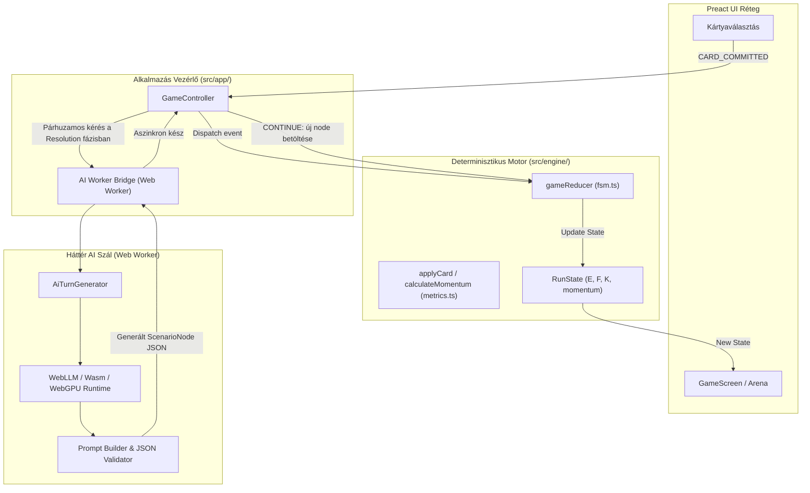
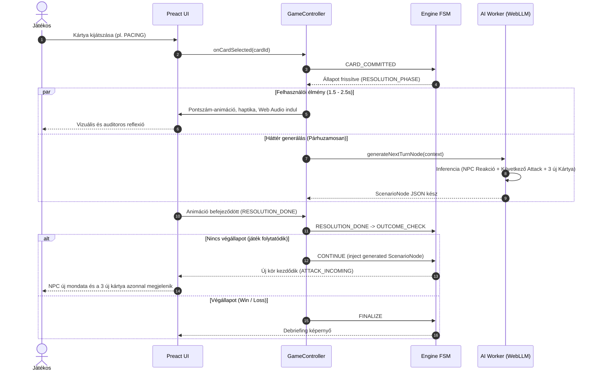
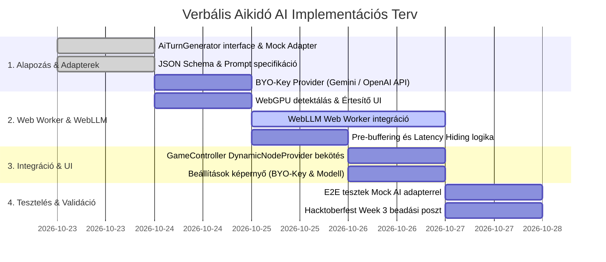

# Verbális Aikidó: Dinamikus Élő AI Ágens Architektúra

| Tulajdonság | Érték |
|---|---|
| **Dokumentum státusza** | Tervezet (v1.0 - Architecture Design) |
| **Dátum** | 2026. október 22. |
| **Referencia dokumentum** | `Verbalis_Aikido_Architecture.md` (v1.0), `schemas/scenario.schema.json` |
| **Célzott fázis** | Fázis 1: Dinamikus Kártyák (Dynamic Turn-by-Turn Card Generation) |
| **Későbbi kiterjesztés** | Fázis 2: Szabad szöveges sparring (Free-form text input + AI Referee) |

---

## 1. Vezetői összefoglaló és célkitűzés

A **Verbális Aikidó** jelenlegi verziója statikus, előre megírt JSON forgatókönyvekre (`public/scenarios/*.json`) épül. Bár a matematikai és pszichofiziológiai modell (Eszkaláció $E$, Belső Földelés $F$, Megakadás $K$, Pánik és Momentum) determinisztikus és szilárd, a tartalom statikussága miatt 1-2 végigjátszás után a játék kiismerhetővé válik, ami drasztikusan csökkenti az újrajátszási értéket (*replayability*).

A jelen architektúra célja egy **kliensoldali AI ágens** integrálása hibrid működési modellel, amely:
1. **Dinamikusan vezeti a párbeszédet:** Minden körben az eddigi kontextushoz és a játékos reakcióihoz igazodva, élőben generálja az NPC indulatait és mondatait.
2. **Körönként friss válaszkártyákat gyárt:** A játékos kezébe adott 3 kártya mindig a konkrét elhangzott mondatra reflektál, betartva a verbális aikidó szabályrendszerét (1 db Pacing, 1 db Meta-modell/Reframing, 1 db Reaktív csapda).
3. **Megőrzi a determinisztikus matematikai motort:** Nem bízza a játék állapotát és számításait az LLM-re; az FSM és a metrikák tiszta TypeScript kódként futnak tovább.
4. **Kétirányú AI motor opció (Rugalmas futtatási modell):**
   * **Helyi WebLLM (Alapértelmezett, 100% kliensoldali & offline):** WebGPU segítségével közvetlenül a böngészőben fut, nulla API költséggel, maximális adatvédelemmel.
   * **Bring-Your-Own-AI (BYO-Key felhős mód):** A felhasználó megadhatja saját API kulcsát (pl. Google Gemini, OpenAI, Anthropic Claude, OpenRouter), így **letöltés nélkül, bármilyen gyenge/régi hardveren** vagy WebGPU nélküli eszközön is azonnal élvezheti a dinamikus AI játékmenetet.

---

## 2. Rendszerarchitektúra és komponens-határok

A meglévő tiszta rétegződés tiszteletben tartásával az AI réteg a vezérlő (`app/`) és az állapotgép (`engine/`) mellé kapcsolódik be, mint egy aszinkron **Tartalom-szállító (Content Provider)**.



### Kulcs tervezési alapelvek:
1. **Független szál (Web Worker):** Az LLM inferencia kizárólag dedikált `Web Worker`-ben fut. A UI szál (Preact) egyetlen ezredmásodpercre sem akadhat meg; az animációk, audio szintézisek és haptikus visszajelzések 60 FPS-sel futnak párhuzamosan.
2. **Determinisztikus matek, generatív szöveg:** Az AI feladata kizárólag a narratíva és a kártyák szövegezése. A kártyák matematikai kategóriáihoz (`PACING`, `META_MODEL`, `ATTACK`, stb.) tartozó metrika-tartományokat a TypeScript motor validálja és szabályozza.
3. **Azonnali felhasználói élmény (Zero Perceived Latency):** A körönkénti AI generálás átfedésben van a felhasználói felület reakció-fázisával.

---

## 3. A Körönkénti Életciklus (Pipeline & Latency Hiding)

A böngészőben futó kis modellek (pl. Llama 3.2 1B vagy SmolLM2) generálási sebessége WebGPU-n átlagosan ~30-60 token/másodperc. Egy kör JSON struktúrája kb. 80-120 token, ami **1.2 – 2.5 másodperces generálási időt** jelent.

A játék ezt a várakozási időt teljes mértékben láthatatlanná teszi a játékos számára:



---

## 4. Típusdefiníciók és Interfészek

A meglévő `src/engine/` és `src/content/types.ts` típusaira épülő új modul: `src/ai/`.

### 4.1. Az AI Turn Context
```typescript
// src/ai/types.ts
import type { CardCategory, MetricTriple, Tone } from '../content/types';

export interface AiTurnContext {
  archetypeId: string;
  npcProfile: {
    name: string;
    role: string;
    coreConflict: string; // pl. "A határidő ma délután jár le, és hiányzik a modul."
    personality: string;  // pl. "Frusztrált, mikromenedzselő, fél a felettesétől."
  };
  turnIndex: number;
  currentMetrics: MetricTriple; // E, F, K
  momentum: number;
  history: Array<{
    turnIndex: number;
    npcStatement: string;
    playerCardText: string;
    playerCategory: CardCategory;
    outcomeTone: Tone;
  }>;
  locale: 'hu' | 'en' | 'de';
}
```

### 4.2. Az AI generált kimenet (Structured Output)
```typescript
export interface AiGeneratedNode {
  npcReaction: string;       // Reakció a játékos előző kártyájára
  nextStatement: string;     // Az NPC következő támadó/vitatkozó mondata
  nextTone: Tone;            // 'ANGRY' | 'FURIOUS' | 'TENSE' | 'SARCASTIC' | 'CALM'
  cards: [
    AiGeneratedCard,         // Garantált PACING kártya
    AiGeneratedCard,         // Garantált META_MODEL vagy REFRAMING kártya
    AiGeneratedCard          // Garantált DEFENSE vagy ATTACK csapda kártya
  ];
}

export interface AiGeneratedCard {
  category: CardCategory;
  text: string;
  debriefHint: string;       // Miért jó vagy veszélyes ez a lépés?
}
```

### 4.3. A szigorú JSON Schema a modell számára
A hibátlan JSON válasz garantálásához a WebLLM `response_format` JSON sémája:

```json
{
  "type": "object",
  "required": ["npcReaction", "nextStatement", "nextTone", "cards"],
  "additionalProperties": false,
  "properties": {
    "npcReaction": { "type": "string" },
    "nextStatement": { "type": "string" },
    "nextTone": { 
      "type": "string", 
      "enum": ["CALM", "TENSE", "ANGRY", "FURIOUS", "SARCASTIC", "COLD"] 
    },
    "cards": {
      "type": "array",
      "minItems": 3,
      "maxItems": 3,
      "items": {
        "type": "object",
        "required": ["category", "text", "debriefHint"],
        "additionalProperties": false,
        "properties": {
          "category": { 
            "type": "string", 
            "enum": ["PACING", "META_MODEL", "REFRAMING", "DEFENSE", "ATTACK"] 
          },
          "text": { "type": "string" },
          "debriefHint": { "type": "string" }
        }
      }
    }
  }
}
```

---

## 5. Rendszerprompt és Aikidó Szabályrendszer

A modell viselkedését egy precízen megtervezett pszichológiai rendszerprompt szabályozza:

```text
Te a "Verbális Aikidó: The Empathy Firewall" interaktív szimuláció narratív motorja vagy.
Szereped: Az NPC ellenfél dinamikus megformálása és 3 darab válaszkártya előállítása.

A KÖVETKEZŐ SZABÁLYOKAT KÖTELEZŐ BETARTANI:
1. NPC TÓNUSA:
   - Ha a játékos konstruktív volt (PACING / REFRAMING): Az NPC enyhül, de nem adja meg magát azonnal; a feszültség fokozatosan csökken.
   - Ha a játékos reaktív volt (DEFENSE / ATTACK): Az NPC eszkalál, számonkér, hangot emel vagy gúnyolódik.

2. A 3 GENERÁLT KÁRTYA ÖSSZETÉTELE:
   - 1. KÁRTYA [PACING]: Érzelmi elismerés és validálás, EGYETÉRTÉS NÉLKÜL. ("Látom, hogy mennyire feszült vagy...", "Hallom, hogy ez neked kritikus...")
   - 2. KÁRTYA [META_MODEL vagy REFRAMING]: Tisztázó kérdés a feltételezésekre (Ki mondta? Mihez képest? Mindig?) VAGY közös szándék beemelése.
   - 3. KÁRTYA [DEFENSE vagy ATTACK] (Reaktív csapda): Magyarázkodás, hárítás, felelősség áthárítása, vagy személyeskedő visszatámadás.

3. NYELV:
   - A válasz nyelve pontosan a megadott locale (${locale}).
   - Természetes, életszerű, munkahelyi stílusban, felesleges mesterkéltség nélkül.
```

---

## 6. Integráció a Játékmotorba (`fsm.ts` és `GameController`)

A meglévő [fsm.ts](file:///d:/dev/__serious_games/Verbalis_Aikido/src/engine/fsm.ts) tisztaságának megőrzése érdekében nem alakítjuk át az FSM-et aszinkronná. Ehelyett a `GameController` kap egy **`DynamicNodeProvider`** képességet:

1. Amikor a játék elindul, a kiválasztott archetípus kezdő node-ja töltődik be (`startNodeId`).
2. A `CARD_COMMITTED` eseménykor a `GameController` a kártya delta értékeit a meglévő matematikai szabályok alapján kiszámolja:
   * `PACING`: $\Delta E \in [-12, -8]$, $\Delta F \in [+6, +10]$, $\Delta K \in [+4, +8]$
   * `META_MODEL`: $\Delta E \in [-6, -2]$, $\Delta F \in [+2, +6]$, $\Delta K \in [+15, +25]$
   * `REFRAMING`: $\Delta E \in [-10, -5]$, $\Delta F \in [+8, +12]$, $\Delta K \in [+10, +18]$
   * `DEFENSE`: $\Delta E \in [+8, +15]$, $\Delta F \in [-10, -5]$, $\Delta K \in [-5, 0]$
   * `ATTACK`: $\Delta E \in [+15, +25]$, $\Delta F \in [-15, -8]$, $\Delta K \in [-10, -5]$
3. A háttérben legenerált `AiGeneratedNode`-ból a rendszer létrehoz egy valós `ScenarioNode`-ot (egyedi `nodeId`-val), és hozzáadja az aktuális futás dinamikus node-gyűjteményéhez.
4. A `CONTINUE` eseménykor a motor már az újonnan hozzáadott dinamikus node-ra lép át.

---

## 7. Futtatókörnyezet és Modell Választás (WebLLM)

### Kiválasztott modellek
A böngészőben való futtatáshoz három, kiváló WebGPU támogatással bíró modellt támogat a rendszer:

| Modell | Méret (VRAM) | Erősség | Ajánlott eszköz |
|---|---|---|---|
| **SmolLM2-1.7B-Instruct-q4f16** | ~900 MB | Kifejezetten gyors, alacsony memóriahasználat | Középkategóriás laptopok, régebbi GPU-k |
| **Llama-3.2-1B-Instruct-q4f16** | ~750 MB | Ultrakönnyű, villámgyors generálás | Mobil eszközök / alap gépek |
| **Llama-3.2-3B-Instruct-q4f16** | ~1.8 GB | Magas nyelvi kifinomultság, gazdagabb szókincs | Asztali gépek dedikált GPU-val |

### Első betöltési élmény (Progressive Onboarding) és WebGPU Detektálás:
* Amikor a felhasználó először választja a helyi „Élő AI Sparring (WebLLM)” módot, a felület megjelenít egy progress bar-t a modell letöltéséhez és inicializálásához.
* A súlyok a böngésző `CacheStorage` / `IndexedDB` tárolójába kerülnek: **a letöltés csak egyszer történik meg**, ezt követően a helyi modell repülőgép-üzemmódban is azonnal indul.

### WebGPU Támogatás Hiányának Kezelése (Aktív Felhasználói Tájékoztatás):
Nem elegendő a WebGPU hiányát csendben elnyomni: a felhasználónak világos, transzparens visszajelzést és cselekvési alternatívákat kell kapnia.
* **Detektálás:** Indításkor a rendszer ellenőrzi: `'gpu' in navigator && (await navigator.gpu.requestAdapter()) !== null`.
* **Ha a WebGPU nem támogatott vagy le van tiltva:**
  * **Informatív értesítés jelenik meg:** Egy barátságos, de egyértelmű információs kártya/banner:
    > *„Az eszközöd vagy böngésződ jelenleg nem támogatja a WebGPU technológiát (vagy a hardveres gyorsítás ki van kapcsolva). A helyi böngészős modell így nem tud elindulni.”*
  * **Felkínált alternatívák (Egykattintásos opciók):**
    1. **Bring-Your-Own-AI (Saját API kulcs):** Váltson át a felhős módra (pl. ingyenes Gemini vagy OpenAI/Claude kulcs), ami azonnal működik GPU nélkül is.
    2. **Klasszikus Forgatókönyvek:** Játsszon a beépített 4 mesteri, statikus szcenárióval.
    3. **Böngésző beállítási segítség:** Rövid instrukció a WebGPU bekapcsolásához (pl. Chrome/Edge hardveres gyorsítás engedélyezése).

---

## 8. Bring-Your-Own-AI (BYO-Key) Hibrid Architektúra

A helyi WebLLM mellett a rendszer egy **Bring-Your-Own-AI (BYO-Key)** módot is biztosít, amellyel a játékos a saját felhős API kulcsát adhatja meg a Beállításokban.

### 8.1. Miért kulcsfontosságú a BYO-Key opció?
1. **Zero-Download (Azonnali indulás):** Nincs 800 MB – 1.8 GB közötti modellletöltés; mobilneten vagy lassabb kapcsolaton is azonnal indítható a játék.
2. **Hardverfüggetlenség:** Régebbi okostelefonokon, alacsony memóriájú irodai laptopokon vagy WebGPU nélküli környezetekben is teljes értékűen működik az élő ágens.
3. **Prémium Modellminőség:** A játékos a legfrissebb, legintelligensebb modellekkel mérheti össze a tudását (pl. Claude 5.5 Sonnet / 5 Haiku, GPT-5 / GPT-5-mini, Google Gemini 3.8 Flash / Pro).
4. **Ingyenes felhős alternatíva:** A Google Gemini 3.8 Flash publikus ingyenes API kvótája révén a felhasználónak egyetlen fillérjébe sem kerül a felhős futtatás.

### 8.2. Támogatott Szolgáltatók és Modellek

| Szolgáltató | Ajánlott Modell | Főbb Előny |
|---|---|---|
| **Google Gemini** | `gemini-3.8-flash` | Bőkezű ingyenes kvóta, rendkívül gyors válaszidő és életszerű szimuláció |
| **Anthropic Claude** | `claude-5-5-sonnet`, `claude-5-haiku` | Kiemelkedő pszichológiai árnyaltság, finom de-eszkalációs dinamikák |
| **OpenAI** | `gpt-5-mini`, `gpt-5` | Precíz strukturált JSON Schema követés és alacsony késleltetés |
| **OpenRouter** | `meta-llama/llama-4`, `qwen-3-instruct` | A legfrissebb nyílt súlyozású modellek felhős elérése |
| **Helyi Ollama** | `qwen3:8b`, `llama4:8b` | Haladó felhasználóknak desktopon (`http://localhost:11434`) |

### 8.3. Adatvédelem és Kulcskezelés (Security Architecture)
* **Kizárólag Kliensoldali Tárolás:** Az API kulcsot a böngésző kizárólag helyben tárolja (`IndexedDB` vagy titkosított `localStorage`).
* **Közvetlen API hívás (Zero Proxy):** A hívások közvetlenül a kliens böngészőjéből indulnak a szolgáltató hivatalos végpontjára (`api.openai.com`, `generativelanguage.googleapis.com`, stb.). Nem létezik köztes szerver, ami naplózhatná a kulcsot vagy a beszélgetéseket.
* **Azonnali visszavonás és tesztelés:** A Beállítások menüben egy *„Kapcsolat tesztelése”* és egy *„Kulcs törlése”* gomb azonnali ellenőrzést és törlést tesz lehetővé.

### 8.4. Az Egységesített Szolgáltató Interfész (Provider Adapter Pattern)

A játékmotor számára teljesen mindegy, hogy a válasz a helyi WebLLM-ből, egy felhős Gemini API-ból vagy egy teszt mock-ból érkezik:

```typescript
// src/ai/providers/types.ts
export interface AiProvider {
  readonly id: 'webllm' | 'gemini' | 'claude' | 'openai' | 'ollama' | 'mock';
  readonly name: string;
  isAvailable(): Promise<boolean>;
  generateNextNode(ctx: AiTurnContext): Promise<AiGeneratedNode>;
}
```

---

## 9. Fejlesztési és bevezetési ütemterv



---

## 10. Kitekintés: Fázis 2 (Szabad szöveges sparring)

Amint a Dinamikus Kártya generálás stabilan működik, a rendszer természetes módon bővíthető a szabad szöveges bevitellel:
1. A játékos a kártya kiválasztása helyett beírhatja a saját szavait egy input mezőbe.
2. Egy könnyű osztályozó prompt besorolja a mondatot az 5 aikidó kategória valamelyikébe, vagy egy kevert pontszámot ad rá (pl. 70% Pacing, 30% Attack).
3. A kategória alapján a determinisztikus metrika-számítás lefut, és a játékmenet pontosan ugyanúgy halad tovább.
